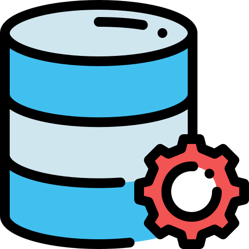

## Cześć, z tej strony Bartek 

**Administrator aplikacji → Oracle Developer → Data Engineer**

Projektuję, optymalizuję i wdrażam rozwiązania bazodanowe w Oracle, tworzę procesy integracji danych oraz rozwijam systemy analityczne i raportowe. Jako administrator aplikacji odpowiadam za utrzymanie i rozwój systemów core wspierających kluczowe procesy biznesowe.

Moja praca to nie tylko kod: analizuję wymagania, współpracuję z dostawcami oprogramowania i zespołami biznesowymi oraz uczestniczę we wdrożeniach. Dzięki temu patrzę na dane nie tylko od strony technicznej, ale też przez pryzmat ich realnego zastosowania.

Obecnie dodatkowo rozwijam kompetencje w obszarze Data Engineeringu: projektuję pipeline'y danych end-to-end, od pozyskania danych z API po gotowe dashboardy, w chmurze oraz z wykorzystaniem narzędzi open-source. Poniżej znajdziesz prywatne projekty, które działają produkcyjnie każdego dnia.

| Projekt | Opis |
|---|---|
| **[PKP&nbsp;Wrocław&nbsp;Główny](https://github.com/bokoniewski/pkp-wroclaw)** | Ruch pociągów na stacji Wrocław Główny — przebieg dzienny i na żywo (co ok. 3 min), architektura Medallion w Oracle Autonomous Database, tablica odjazdów na żywo i statystyki punktualności |
| **[Rynek&nbsp;pracy&nbsp;IT](https://github.com/bokoniewski/rynek-pracy-it)** | Codzienny pipeline zbierający oferty pracy IT z kilku portali, architektura Medallion, dashboard z trendami rynku |

## Kontakt

&nbsp;&nbsp;<a href="https://www.bokoniewski.pl"><b>bokoniewski.pl</b></a>
&nbsp;&nbsp;&nbsp;&nbsp;&nbsp;&nbsp;
&nbsp;&nbsp;<a href="https://www.linkedin.com/in/bart%C5%82omiej-okoniewski-3136a4133/"><b>LinkedIn</b></a>
